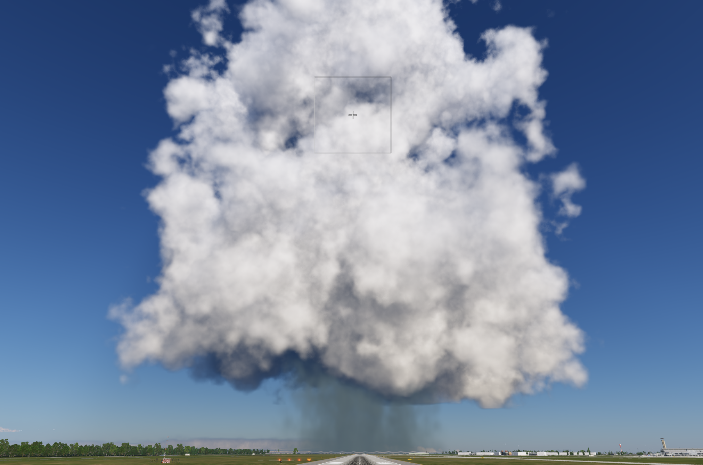
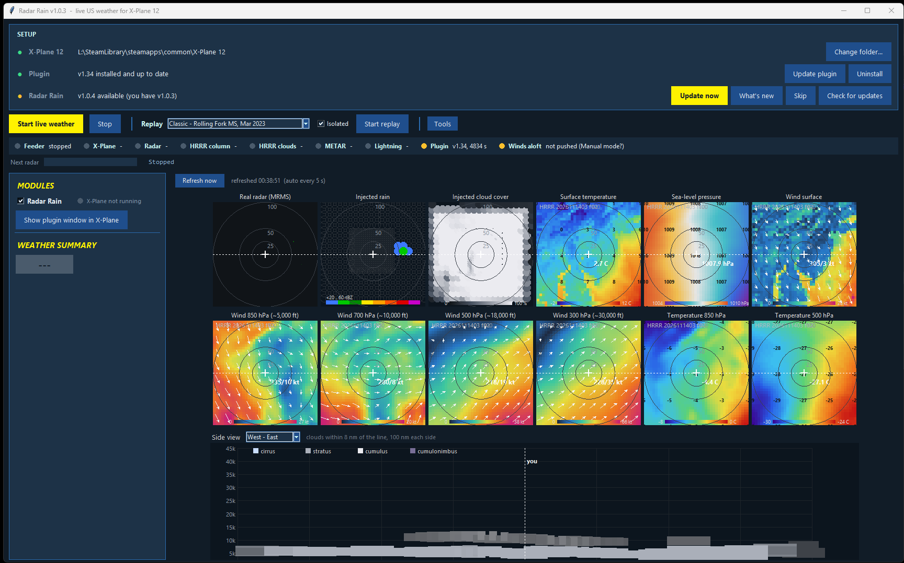
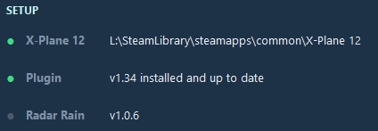

# Radar Rain

**Live US weather for X-Plane 12, built from real NOAA radar and observations.**

Rain falls where it is actually raining, right now. Radar Rain reads the national radar mosaic every two minutes and turns it into rain shafts, clouds, winds and turbulence in X-Plane, then checks the result against nearby airport reports and satellite cloud cover.

<!-- IMAGE: hero shot, rain shafts in front of the aircraft -->

**[Download the latest version](https://github.com/OwnPCNOOB/radar-rain-releases/releases/latest)**

---

## What it does

| | |
|---|---|
| **Radar rain** | NOAA MRMS radar (about 1 km detail, new every 2 minutes) places rain exactly where it is falling, from light drizzle to heavy storm cores, with visible rain shafts under the clouds |
| **Clouds** | Layers built from the HRRR weather model, corrected by GOES-19 satellite cloud cover and nearby METAR reports (broken and overcast decks) |
| **Winds and turbulence** | Wind, temperature and turbulence by altitude from the HRRR model |
| **Lightning** | GOES-19 lightning data around storms |
| **Day and night** | Rain lighting follows the sun: silver when backlit, darker in cloud shadow, softer at night with a warm glow over lit cities |
| **Weather dashboard** | Radar, injected rain and clouds, winds and temperatures at several altitudes, a side view of the cloud layers, and a summary of the weather at your position |
| **Updates itself** | Checks for new versions on start and installs them with one click |

<!-- IMAGE: storm with rain shafts from outside the aircraft -->

<!-- IMAGE: the Radar Rain app window -->

---

## Requirements

- **X-Plane 12.3 or newer** on Windows
- **[XPPython3 v4](https://xppython3.readthedocs.io)** (free). It includes its own Python, so you do **not** need to install Python.
- An internet connection

---

## Install

1. **Install XPPython3** into `X-Plane 12\Resources\plugins` (follow its install page).
2. **Download** `RadarRain-x.y.z.zip` from the [latest release](https://github.com/OwnPCNOOB/radar-rain-releases/releases/latest), unzip it anywhere (the Desktop is fine) and run **RadarRain.exe**.
3. Radar Rain finds X-Plane 12 by itself. If it does not, press **Change folder...** and pick the X-Plane 12 folder (the one with `X-Plane.exe`).
4. Press **Install plugin**.
5. Start X-Plane, then press **Start live weather** in Radar Rain.

> **Windows warning:** Windows may show *"Windows protected your PC"* because the app is not code-signed. Click **More info**, then **Run anyway**.

<!-- IMAGE: the Setup panel with green status lights -->

The three lights in the Setup panel tell you where things stand:

| Light | Meaning |
|---|---|
| Green | All good |
| Yellow | Something to do: plugin not installed or outdated, or an update is available |
| Red | Something missing: X-Plane not found, or XPPython3 not installed |

---

## Using it

- **Start live weather** begins downloading radar and model data and sends it to X-Plane. The status bar shows each source (radar, HRRR, METAR, lightning) as it comes in.
- In X-Plane, **Plugins > Radar Rain** has the plugin's own menu. After changing weather settings in X-Plane, use **Refresh weather now** there.
- **Replay** plays back a past storm (for example the Rolling Fork, MS tornado outbreak of March 2023) so you can fly through real severe weather any time.
- **Stop** ends the live weather.

<!-- IMAGE: flying through rain at night -->

---

## Updating

Radar Rain checks for updates when it starts (at most every 6 hours). When one is available, the Radar Rain row turns yellow:

- **Update now** downloads the new version, checks that it arrived intact, restarts Radar Rain and offers to update the X-Plane plugin.
- **What's new** shows the release notes.
- **Skip** hides that version.

You can also press **Check for updates** any time. The previous version is kept next to the app as `RadarRain.old.exe`.

---

## Uninstall

Press **Uninstall** in Radar Rain. It puts X-Plane's own weather files back and removes the plugin. Then delete `RadarRain.exe`.

---

## Known limits

- **Radar rain covers the continental US only.** Outside it you get X-Plane's weather, adjusted by nearby METAR reports.
- Clouds can show as broken where nearby airports report overcast (being worked on).
- Some antivirus programs flag single-file Python apps by mistake. If yours does, it is a false positive caused by the packaging.

---

## Data sources

All weather data is free and public:

- **[NOAA MRMS](https://www.nssl.noaa.gov/projects/mrms/)**: radar mosaic and precipitation
- **[NOAA HRRR](https://rapidrefresh.noaa.gov/hrrr/)**: clouds, winds, temperature, turbulence
- **[NOAA/NASA GOES-19](https://www.goes-r.gov/)**: satellite cloud mask and lightning (GLM)
- **[Aviation Weather Center](https://aviationweather.gov)**: METAR reports
- **[NASA Black Marble](https://blackmarble.gsfc.nasa.gov/)**: city lights at night

Radar Rain is a flight-simulation add-on. **Do not use it for real-world flight planning or navigation.**

---

## Problems or ideas?

Open an [issue](https://github.com/OwnPCNOOB/radar-rain-releases/issues) and include:
- what happened, and what you expected
- your Radar Rain version (bottom row of the Setup panel)
- if the problem is in X-Plane, `Log.txt` and `XPPython3Log.txt` from the X-Plane 12 folder
